<picture>
  <source media="(prefers-color-scheme: dark)" srcset="assets/hero-dark.svg">
  
</picture>

 

[counselrise.com](https://counselrise.com) &nbsp;&nbsp; [LinkedIn](https://www.linkedin.com/in/georgekandilas) &nbsp;&nbsp; [kdngiorgos.site](https://www.kdngiorgos.site) &nbsp;&nbsp; [kdngiorgos@gmail.com](mailto:kdngiorgos@gmail.com)

### What I do

**Counselrise.** An SEO and AI search visibility consultancy for service businesses. When ChatGPT, Perplexity or Google's AI Overviews answer a question in your market, we work on making you the source they cite.

**Production infrastructure.** I own the stack behind 20+ e-commerce sites. I moved them off managed hosting onto self-managed Hetzner, put Cloudflare Tunnels in front, locked down the origin and wired up mail and uptime monitoring. When something breaks at 3 a.m., I'm the one who gets paged. Hosting costs dropped by about €860 a year.

**Agents that do real work.** Hermes runs day-to-day e-shop operations on Gemini, with memory split into rules and facts so it stays cheap and grounded. A six-agent version serves a 13-site client network.

**Security.** 2nd of ~400 at CSCG 2026 in binary exploitation, web and network pentesting. Member of the ISSG Hacking Group, and founder of the Cybersecurity SIG at ACM UPatras, which I still lead.

### Before this

| Where | What | When |
|---|---|---|
| **SacredByte GmbH**, Berlin | IT systems and security. Built the secure baseline for SMB clients (Google Workspace hardening, MDM, access control) and ran a vendor evaluation across 20+ criteria | 2026 |
| **Demetra** | Co-founder. AgTech on satellite and sensor data. Took a team of five from idea to MVP in 8 months and won 1st place at Invent for the Planet 2025 | 2025 |
| **PwC Greece** | Software Academy, full-stack programme | 2025–26 |

### Open source

[**ceid-notes**](https://github.com/kdngiorgos/ceid-notes) gives Patras computer engineering students study guides and a past-exam archive with worked solutions, organised by topic.

[**MunicipalBudgetVisualization**](https://github.com/kdngiorgos/MunicipalBudgetVisualization) turns a Greek municipal budget into something a resident can actually read.

The client and company work lives in private repos. I'm happy to walk you through it.

### Elsewhere

Computer Engineering & Informatics at the University of Patras. ISC2 Certified in Cybersecurity. Former Greek school-level weightlifting champion (176 kg total at 81 kg). Off the clock you'll find me riding to Foloi forest or dying to a FromSoftware boss.

Talk to me about AI search, running production on your own hardware, or security for small teams.
